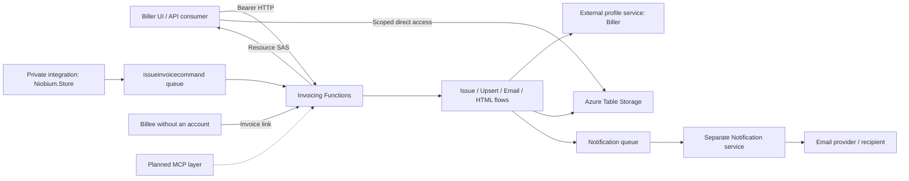
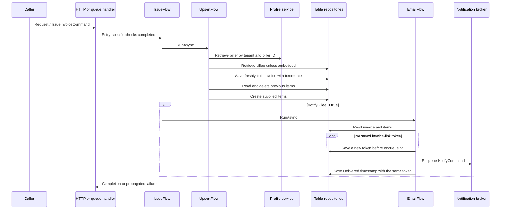

# Architecture and flows

## Context and ownership

The application is a .NET 10 Azure Functions isolated worker. `Contracts` supplies shared models/arithmetic, `Core` orchestrates and renders, and `Server` supplies transport entry points and composition. `Core.Tests` references Core and Contracts. Server references Core, which references Contracts. Niobium NuGet packages provide infrastructure abstractions/adapters; [matched versions](niobium-integration.md) matter.

API and table SAS are separate access paths. Queue access is an infrastructure trust boundary; it does not repeat HTTP user checks. Profile authorization, Notification templates/provider acceptance and actual Azure deployment state are external responsibilities. A management group is not a Notification sender tenant: the sender is the biller (Q02).

## Initialization and lifetimes

Evidence: [Program.cs](../src/Niobium.Invoicing.Server/Program.cs), Server [DependencyModule](../src/Niobium.Invoicing.Server/DependencyModule.cs), Core [DependencyModule](../src/Niobium.Invoicing.Core/DependencyModule.cs), and pinned framework sources in [integration](niobium-integration.md).

1. `FunctionsApplication.CreateBuilder` and `ConfigureFunctionsWebApplication` establish Functions/ASP.NET integration.
2. `AddInvoicing` adds platform, identity, service-principal profile access, messaging, tables, resource-token support and Core.
3. Core binds `BillingOptions`, selects development messaging, sets IdentityModel PII logging according to the framework development check, and scans its assembly for domain components/flows.
4. Server registers invoice-item ownership control/default table entitlements and a `NotifyCommand` broker using `NotificationQueueOptions`.
5. `UsePlatformIdentity` composes HTTP context access, error handling, bearer parsing, access-token issuance and resource-token middleware, in that order.
6. `Build().Run()` starts the host. It was not run during discovery/validation.

Flows, domains, repositories and relevant profile/broker registrations are transient; the HTTP context accessor is singleton. `Lazy<T>` supports deferred resolution. Static `loaded` flags guard registration process-wide, so separate builders in one process cannot be assumed independent. Templates also use static caches. No application-specific domain-event handlers are registered here; generic support does not prove an application event publication workflow.

Health services are registered by the platform, but startup does not call the route-mapping extension for `/health` or `/alive`. No corresponding Functions exist here.

## Issuance and partial failures

HTTP issuance forces `NotifyBillee=false`. The trusted message path can notify and supplies an embedded billee. `IssueFlow` does not combine stages into a transaction. `UpsertFlow` creates a fresh invoice/domain rather than loading the existing invoice. Its delivered check does not establish a durable edit lock across retries.

Failure boundaries matter: profile lookup may fail before writes; invoice save can succeed before item replacement fails; item deletion can succeed before creation fails. New token persistence precedes enqueueing, so its failure prevents notification publication. Enqueueing can still succeed before Delivered persistence fails. Repeating the operation can repeat earlier work. Azure batch limits apply within repository operations, not across the flow. See [persistence](domain-and-data.md) and [retry contracts](api-and-messaging.md).

## Viewing and sending

`HTMLFlow.RunAsync` retrieves an invoice domain, requires a matching saved link token, renders encoded invoice parameters, enumerates item domains, renders each encoded line and replaces the marked line block in the embedded template. `HtmlTemplate` performs single-pass substitution; URL attributes are prepared separately. Formatting uses stored invoice culture/timezone and selected currency formatters. Rendering has no storage write. Saved `Template` does not select the HTML resource.

`EmailFlow.RunAsync` reads persisted data and returns early for a blank recipient email. `InvoiceDomain.EnsureAccessTokenAsync` reuses an existing saved token or creates and saves a new one. The flow builds unencoded invoice/line parameters and `NotifyCommand`, enqueues, then calls `OnDeliveredAsync`. Existing emailed links retain their token on resend (Q17). Provider delivery is outside this application. `Delivered` is an observed enqueue-related timestamp, despite its name.

There is no lifecycle enum or persistent Delivering/Cancelled state. Intended transitions (Q04/Q10) are editable invoice -> queued/Delivering with content frozen -> confirmed Delivered. Cancellation before any payment is planned. These transitions depend on downstream changes and are deferred.

## Decisions and limits

The owner confirmed that overwrite-based persistence was originally a simple retry/idempotency strategy for trusted usage, and private queue integration intentionally omits user-principal checks. These are retrospective explanations, not inferred historical decisions. Other rationale remains Unknown. See [decisions](decisions-and-risks.md); this documentation did not implement a redesign.
